# Microplastic Detection and Quantification using Machine Learning and Computer Vision

A low-cost, portable, AI-assisted system for quantification and polymer classification of microplastics in water using multi-angle light scattering, fluorescence imaging, and deep learning.


---

# Overview

Microplastic pollution has become a major environmental challenge worldwide. Traditional methods such as FTIR, Raman spectroscopy, and Py-GC/MS provide excellent accuracy but require expensive laboratory infrastructure and trained personnel.

This project proposes a low-cost, field-deployable microplastic detection platform that combines:

- Multi-angle light scattering (MALS)
- Fluorescence imaging using Nile Red staining
- Computer vision-based polymer identification
- Machine learning-based concentration estimation
- Real-time edge deployment capability

The system aims to detect and quantify microplastic particles ranging from **10–100 μm** while providing polymer classification using deep learning.

---

# What Is Demonstrated, and What Is Not

| Part | State | Evidence |
|---|---|---|
| Image dataset audit | Done | 2040 files are 600 near-duplicate groups; every split is made by group (`DATASET_CARD.md`) |
| Polymer identification (per-particle classifier) | Done, with a caveat | CV accuracy 0.976, hold-out 0.987 (95 % CI 0.952 to 1.000). A model that sees only the particle-free background still reaches 0.906 balanced accuracy, so part of the signal is acquisition, not polymer (`MODEL_CARD.md`) Phase 5: shape features alone reach CV accuracy 0.864 with background discs at chance (0.516); every pixel-based feature set also separates the classes on background discs (0.709 to 0.938), and none of the three tested variants improves on both controls |
| YOLOv11 instance segmentation | Trained, on automatic masks | 30-epoch budget with patience 10, batch 6, final-epoch weights on an RTX 3050; mask mAP50 0.739 ± 0.019 and mask mAP50-95 0.321 ± 0.013 over five folds, measured against the classical segmentation's masks (no human-corrected masks exist); image accuracy 0.887 ± 0.121 (`results/yolo_summary.md`) |
| Concentration estimation | Rig model only | No measured scattering data exist. The results come from a simulator of the rig (see below); best model lasso, R² 0.81 |
| Hardware | Not built or measured as described | Detector angles, distances, amplifier gain, laser power and ADC are placeholders (`docs/hardware/`) |
| Pixel size (µm per pixel) | Not calibrated | Sizes are reported in pixels |
| Demo app and `mp analyse` | Works on this machine | Quality gates withhold a polymer label when the input is unsuitable; every concentration estimate is labelled as a rig model estimate |
| Edge deployment | Not run on a Raspberry Pi | 176 ms median per image on this machine's CPU (12 threads, `results/deploy_benchmark.json`); the Pi table in `docs/raspberry_pi.md` says "not run" |

# Quick Start

```bash
git clone https://github.com/faizdevx/microplastic-detection-ml.git
cd microplastic-detection-ml
pip install -e ".[dev]"

make all           # data, audit, features, classifier, controls, scattering model, regression
make release-check  # lint, tests, claims audit, claims against evidence
python app/app.py  # local demo at http://127.0.0.1:7860
pytest
```

`make all` downloads the 548 MB image archive, never evaluates the hold-out and does not train
YOLOv11-seg (`make train-seg-full`, GPU recommended). Single steps: `make data`, `make audit`,
`make features train-cls controls`, `make sim sim-analyse train-reg`, `make report-phase2 report-phase3`.

Analyse an image and/or four detector counts (output format: `docs/api.md`):

```bash
python -m mp.cli analyse --image app/examples/nylon_example.jpg --sensors 160 70 64 64
```

```
polymer: NYLON (P(NYLON) 0.879, confidence 0.879); probabilities are not well calibrated (hold-out ECE 0.125)
particles: 24; size histogram (px) [10, 7, 5, 2, 0, 0, 0, 0]
concentration: 2.62 mg/L (90 % interval 1.14 to 6.03); rig model estimate, not a measurement
warning: class is partly predictable from background and exposure alone; see MODEL_CARD.md
```

# Repository Map

```bash
microplastic-detection-ml/
├── src/mp/
│   ├── data/        fetch, near-duplicate groups, audit, splits, group-aware loader
│   ├── imaging/     normalisation, segmentation, per-particle features, scale calibration
│   ├── models/      polymer classifier, YOLO-seg pipeline, concentration regression
│   ├── eval/        metrics, confound controls, explainability, hold-out report
│   ├── annotate/    auto masks, correction export/import, mask IoU
│   ├── scatter/     Mie model, photon Monte Carlo, detector chain, analyses
│   ├── deploy/      ONNX export, benchmark, camera capture
│   └── analyse.py   `mp analyse`
├── app/             Gradio demo and example images
├── configs/         data, classifier, yolo_seg, scattering, regression
├── data/processed/  groups.csv, splits.json, scattering_v1.csv
├── docs/            api, scattering model, literature parameters, hardware, Raspberry Pi, annotation
├── results/         generated JSON, summaries, figures and the claims audit
├── tests/  tools/   offline tests; checksum, requirements and audit scripts
├── MODEL_CARD.md  DATASET_CARD.md  RELEASE_NOTES.md  CITATION.cff
└── Makefile  Dockerfile  environment.yml
```

---

# Results at a Glance

Everything below is generated by the commands above; the numbers live in `results/`.

### Fluorescence images and automatic segmentation

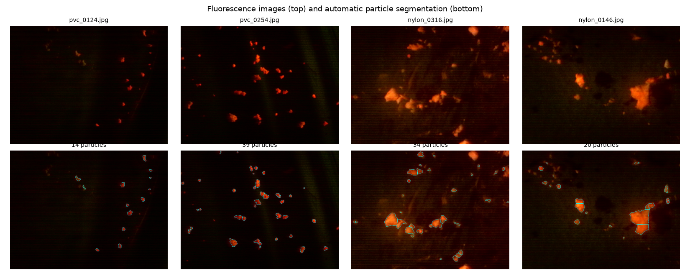

Nylon images are brighter and have a different background than PVC images; this is the
acquisition difference the confound controls test for.

### Dataset: what is in the archive

| PVC | NYLON |
|---|---|
| 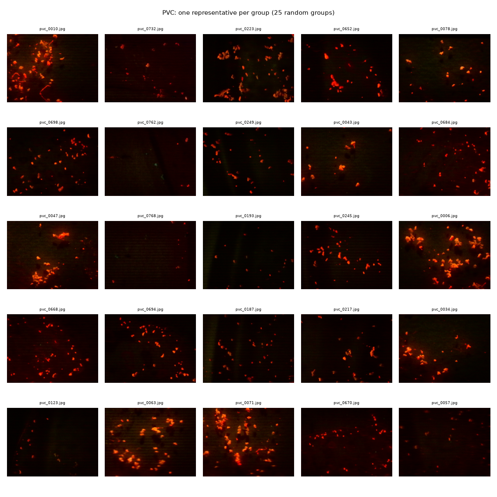 | 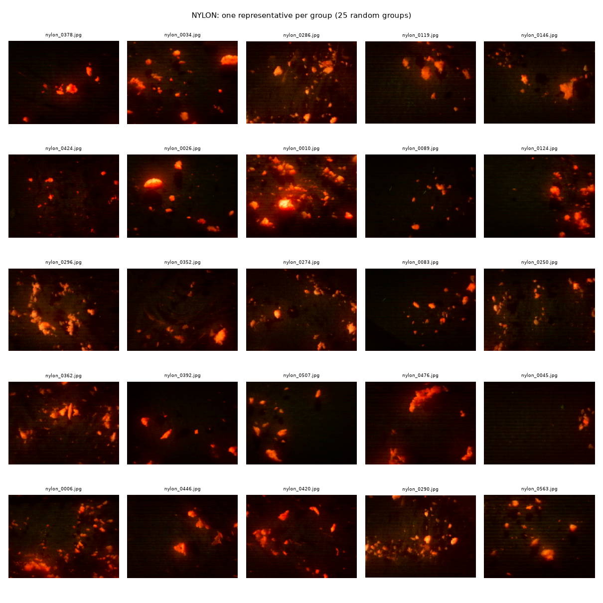 |

### Polymer identification

| Feature importance | Hold-out reliability |
|---|---|
| 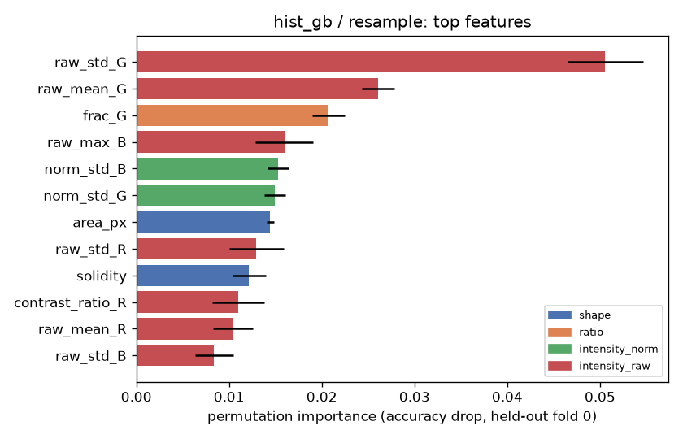 | 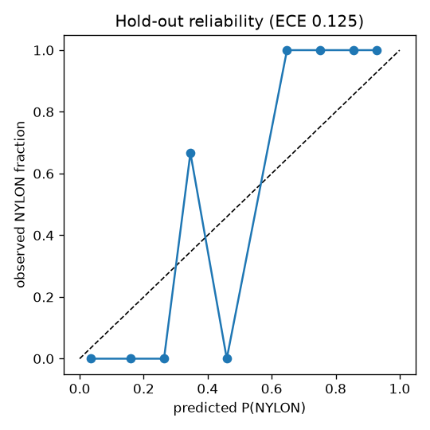 |

The two hold-out errors (Nylon predicted as PVC):

| | |
|---|---|
| 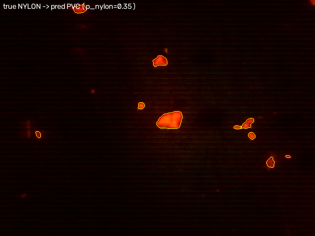 | 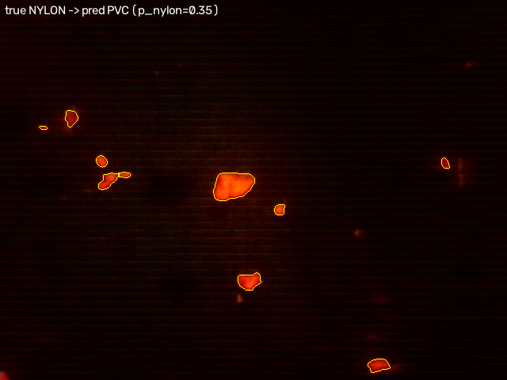 |

### Confound controls

| Variants under each control | Feature sets under the background-discs control |
|---|---|
| 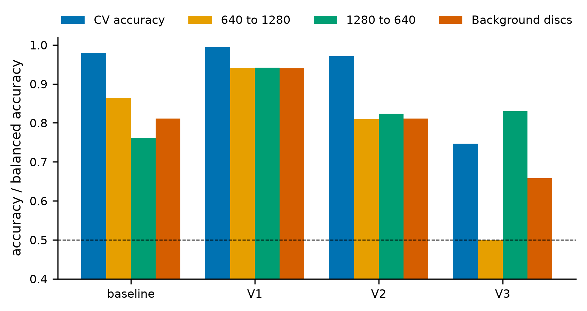 | 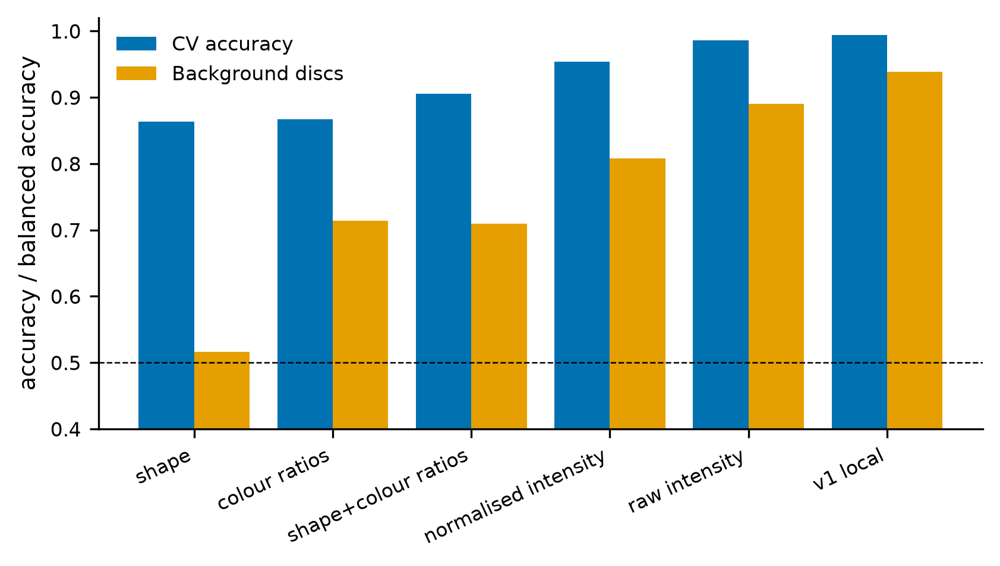 |

Cross-validation accuracy stays high while the cross-resolution and background-disc controls
drop, so part of the accuracy comes from acquisition cues (`results/phase5_summary.md`).

### YOLOv11 instance segmentation

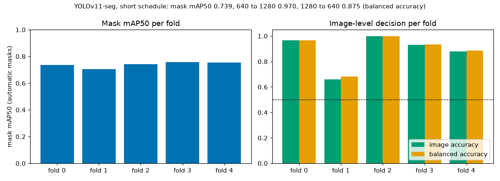

Mask mAP50 is agreement with the automatic masks, not with human-drawn outlines, and the
image decision varies between folds (`results/yolo_summary.md`).

### Concentration estimation (rig model)

| Angular scattering | Signal vs concentration |
|---|---|
| 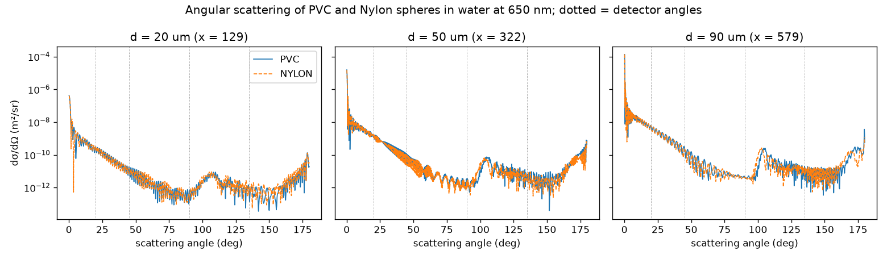 | 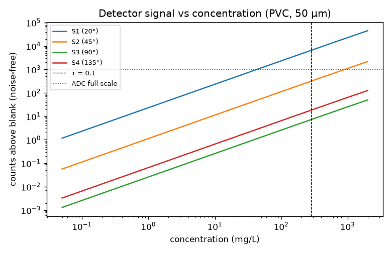 |

| Sensitivity to rig parameters | Regression, unseen concentration levels |
|---|---|
| 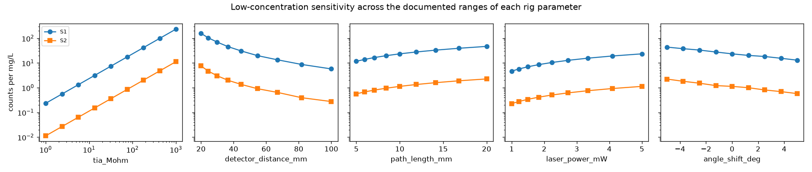 | 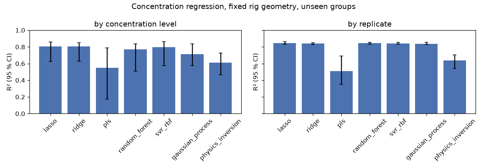 |

Details: `MODEL_CARD.md`, `DATASET_CARD.md`, `docs/scattering_model.md`,
`results/phase2_summary.md`, `results/phase3_summary.md`.

---

# Repository

### GitHub Repository

https://github.com/faizdevx/microplastic-detection-ml

---

# Dataset and Research Archive

The complete dataset, supplementary materials, training configurations, and experimental records are archived on Zenodo.

### Zenodo Archive

https://zenodo.org/records/21073653

### DOI

```
10.5281/zenodo.21073653
```

---

# Research Paper

### Title

**Machine Learning based algorithm for quantification and detection of different types of Microplastic in Water Sample**

### Authors

- Gaurav Joshi
- Shashwat Singh
- Shiv Kumar Gupta
- Faisal Arif Ansari
- Aviral Madhvan
- Dhirendra Kumar Sharma
- Sweta Shukla

---

# System Architecture

The proposed system consists of two major subsystems:

## 1. Quantification Module

Uses:

- 650 nm laser source
- Multi-angle scattering
- BPW34 photodiodes
- Mie scattering analysis
- Machine learning regression

```
Water Sample
      ↓
Laser Scattering
      ↓
Photodiode Measurements
      ↓
Feature Extraction
      ↓
ML Regression
      ↓
Microplastic Concentration
```

---

## 2. Polymer Identification Module

Uses:

- Nile Red fluorescence staining
- 365 nm UV excitation
- Optical filtering
- Raspberry Pi Global Shutter Camera
- YOLOv11 instance segmentation

```
Microplastic Sample
        ↓
Nile Red Staining
        ↓
UV Excitation
        ↓
Fluorescence Imaging
        ↓
YOLOv11 Segmentation
        ↓
Polymer Classification
```

---

# Hardware Components

| Component | Specification |
|-----------|--------------|
| Laser | 650 nm |
| UV LED | 365 nm |
| Camera | Raspberry Pi Global Shutter Camera |
| Sensor | BPW34 Photodiodes |
| Lens | 10× Objective |
| Controller | Raspberry Pi 5 |
| Optical Filter | 520 nm Bandpass Filter |
| Detection Range | 10–100 μm |

---

# Machine Learning Models

## Concentration Estimation

**Status of the scattering results.** There is no measured scattering dataset in this
repository. The concentration results below come from a physics-based simulator of the
rig (Mie theory for the particles, a photon Monte Carlo for multiple scattering, and a
photodiode, amplifier and ADC model), so they validate the regression method, not an
instrument. The rig values (detector angles, distances, amplifier gain, laser power, ADC)
have not been measured; they are parameters in `configs/scattering.yaml`, and the analyses
sweep them. `final_dataset.csv` (the earlier S1-S4 table) has no documented origin and is
not used for any result here.

Data: `data/processed/scattering_v1.csv` (`source` column = `simulated`), produced by
`make sim`. Regression: `make train-reg`; the full tables are in `results/phase3_summary.md`.

Models: Lasso, Ridge, PLS, Random Forest, SVR (RBF), Gaussian process, and an inversion
of the forward model. Features: dark-subtracted S1-S4, log S, S_mean, S_std, S1/S4, S2/S4,
S1/S3 and a forward/backward ratio.

Fixed rig geometry, concentration levels unseen in training (5-fold, grouped):

| Model | R² (95 % CI) | MAE mg/L | MAPE % | 90 % interval coverage |
|---|---|---|---|---|
| lasso | 0.807 (0.627 to 0.858) | 0.745 | 46.4 | 0.88 |
| ridge | 0.804 (0.629 to 0.850) | 0.746 | 46.3 | 0.88 |
| pls | 0.550 (0.174 to 0.787) | 0.936 | 52.2 | 0.91 |
| random_forest | 0.771 (0.512 to 0.837) | 0.834 | 47.8 | 0.93 |
| svr_rbf | 0.797 (0.578 to 0.862) | 0.787 | 43.5 | 0.93 |
| gaussian_process | 0.715 (0.576 to 0.836) | 0.842 | 46.1 | 0.90 |
| physics_inversion | 0.613 (0.466 to 0.728) | 0.896 | 45.5 | 0.92 |

Reading these numbers:

- Accuracy is limited by particle-number noise: at 0.1-10 mg/L there are only a handful of
  50 µm particles in the illuminated volume of a reading, so MAPE stays around
  43 % even for the best model (lasso).
- Trained on one geometry and tested on others (angles ±5°, distance ±10 %, gain ±20 %),
  the log10 R² of the random forest goes from 0.85 to 0.80, and of Lasso to
  0.76; if the blank level is not re-measured on the new geometry the linear models fail
  (`results/phase3_summary.md`). Calibration on the real rig geometry matters.
- Scattering alone barely separates PVC from Nylon: at 10 mg/L, S1 differs by
  16 % (d′ = 1.6), mostly through
  density (more particles per mg/L for Nylon), not refractive index. Polymer identity comes
  from the imaging module.
- With the default rig values the 10-bit ADC saturates S1 at about
  45 mg/L, and S3 and S4 (90° and 135°) carry almost no signal.

| Angular curves | Linearity |
|---|---|
|  |  |

| Geometry sensitivity | Regression |
|---|---|
|  |  |

Equations, assumptions and limits: `docs/scattering_model.md`. Sources for every constant:
`docs/literature_params.csv`.

---

## Polymer Classification

Two classifiers are implemented, both split by near-duplicate **group** using
`data/processed/splits.json`:

1. **Baseline A (reported below):** per-particle classical features, background-corrected
   Nile Red channel, Otsu + watershed segmentation, logistic regression / random forest /
   histogram gradient boosting, aggregated to one prediction per image.
2. **YOLOv11-seg (`configs/yolo_seg.yaml`):** trained with `python tools/run_yolo_all.py` (30-epoch budget with patience 10, batch 6, final-epoch weights); results in `results/yolo_summary.md`. Masks are the classical segmentation's output, so the model imitates it; correct masks with `annotate-import` (see `docs/annotation_guide.md`) to measure against human outlines.

Classes: PVC, Nylon.

---

# Dataset Statistics

Numbers below are generated by `make audit` from `RAW_DATASET.zip` (Zenodo
[10.5281/zenodo.21073653](https://zenodo.org/records/21073653)); full detail is in
`results/data_audit.json` and `DATASET_CARD.md`.

| Class | Files | Unique groups | Exact-duplicate files | Sessions | Resolutions |
|---|---|---|---|---|---|
| NYLON | 1084 | 315 | 542 | 8 | 742x556 (424), 1280x960 (200), 780x585 (128), 640x480 (96) |
| PVC | 956 | 285 | 478 | 2 | 640x480 (764), 1280x960 (192) |

Near-duplicate threshold: pHash Hamming distance <= 6.

| Shortcut baseline (group-aware 5-fold CV) | Logistic regression | Random forest |
|---|---|---|
| size_only | 0.753 ± 0.040 | 0.883 ± 0.019 |
| size_and_intensity | 0.895 ± 0.035 | 0.971 ± 0.012 |

Metadata/intensity-only classifiers reach 0.971 group-aware CV accuracy (threshold 0.7): class is predictable without looking at particles.

The archive holds **2040 image files** but only
**600 near-duplicate groups** (an upper bound on independent images). Treat file counts as augmented/duplicated copies, not
independent samples. All splits (`data/processed/splits.json`) are made at group level.

Example images (one representative per near-duplicate group) and the group-size distribution:

| PVC | NYLON |
|---|---|
|  |  |

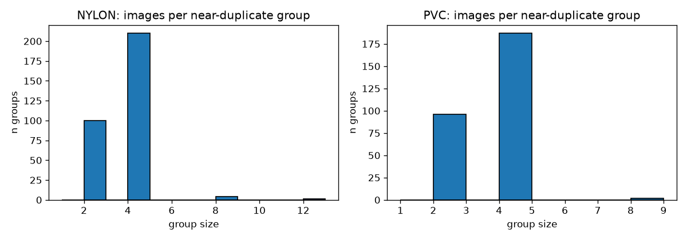

Reproduce:

```bash
pip install -e ".[dev]"
make data    # download, md5-verify, extract, build manifest
make audit   # groups, audit, splits
```

---

# Computer Vision Performance

Generated by `make train-cls controls` and `python -m mp.cli report-phase2 --holdout`; source
files are `results/phase2_cv.json`, `results/phase2_controls.json`, `results/phase2_holdout.json`.


Selected on CV only: **hist_gb** `{'max_iter': 100, 'learning_rate': 0.1, 'max_leaf_nodes': 31}` on geometry `resample`.

### Cross-validation (5 group-aware folds, image level)

| Geometry | Model | Pooled accuracy | Fold mean ± std | Macro-F1 | ROC-AUC |
|---|---|---|---|---|---|
| resample | logreg | 0.972 | 0.972 ± 0.014 | 0.972 | 0.996 |
| resample | random_forest | 0.971 | 0.971 ± 0.021 | 0.971 | 0.995 |
| resample | hist_gb | 0.976 | 0.976 ± 0.013 | 0.976 | 0.997 |
| native | logreg | 0.940 | 0.940 ± 0.027 | 0.940 | 0.984 |
| native | random_forest | 0.940 | 0.940 ± 0.035 | 0.940 | 0.987 |
| native | hist_gb | 0.951 | 0.951 ± 0.022 | 0.951 | 0.991 |

### Controls (balanced accuracy unless noted)

| Geometry | Shortcut CV (size+intensity) | Res.-matched model / shortcut | 640→1280 model / shortcut | 1280→640 model / shortcut | Background-only | Permutation p | Passes |
|---|---|---|---|---|---|---|---|
| resample | 0.958 | 0.957 / 0.914 | 0.864 / 0.506 | 0.762 / 0.679 | 0.906 | 0.010 | no |
| native | 0.958 | 0.947 / 0.914 | 0.613 / 0.506 | 0.650 / 0.679 | 0.907 | 0.010 | no |

Feature-group ablation (HistGB, accuracy):

| Geometry | shape | ratio | intensity_norm | intensity_raw | all |
|---|---|---|---|---|---|
| resample | 0.868 | 0.862 | 0.953 | 0.983 | 0.978 |
| native | 0.732 | 0.871 | 0.931 | 0.977 | 0.953 |

### Hold-out (evaluated once)

| Metric | Value | 95 % CI (group bootstrap) |
|---|---|---|
| accuracy | 0.987 | 0.952 - 1.000 |
| balanced_accuracy | 0.988 | 0.958 - 1.000 |
| macro_f1 | 0.987 | 0.951 - 1.000 |
| roc_auc | 0.999 | 0.996 - 1.000 |

Confusion matrix (rows true PVC/NYLON): [[74, 0], [2, 79]]; ECE 0.125; 155 images.

**Reading the numbers.** Accuracy is high, but the controls say it should not be read as
"the model recognises polymer chemistry":

- A classifier that sees **only the particle-free background** of each image reaches
  0.906 balanced accuracy, so class is encoded
  outside the particles (illumination, noise, exposure). The background-only control is far
  from chance, so the pass rule is **not met** (`passes: no`).
- Raw (exposure-dependent) intensity features carry most of the signal; shape and colour
  ratios alone reach about 0.87 and
  0.86 accuracy.
- The model does beat the metadata shortcut on resolution-matched data and when trained on
  640×480 and tested on 1280×960 (0.864
  vs 0.506
  balanced accuracy), so part of the signal is genuinely in the particles.
- YOLOv11-seg: mask mAP50 0.739 ± 0.019 against automatic masks; its image-level cross-resolution balanced accuracy (0.970 and 0.875) is higher than the per-particle classifier's (0.864 and 0.762), but the network sees the background and no background control was run for it.

**Figures** (generated):

| Feature importance | Class differences (Cohen's d) | Hold-out reliability |
|---|---|---|
|  | 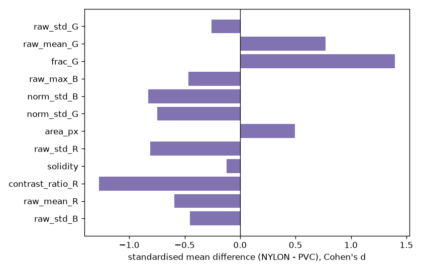 |  |

Hold-out errors with the auto-segmentation overlaid: `results/figures/phase2_failures/`.

Details and limits are in `MODEL_CARD.md`.

---

# Optical Physics

The scattering model (`src/mp/scatter/`) is built from:

- Mie theory for spheres of PVC (n = 1.54) and Nylon-6 (n = 1.53) in water (n = 1.331) at 650 nm
- Number density from mass concentration for a log-normal size distribution
- Beer-Lambert attenuation, a transport-cross-section correction, and a photon Monte Carlo
  with next-event detector estimates for multiple scattering
- BPW34 photodiode, transimpedance amplifier, shot / dark / Johnson noise, laser drift,
  particle-number (Poisson) noise, and ADC quantisation and clipping

For particles of 10-100 µm and a 650 nm laser the size parameter is about 64-640, so
scattering is strongly forward peaked. Optical depth over the 10 mm path reaches 0.1 at
279 mg/L, so the 0.1-10 mg/L working range is almost entirely
single scattering; multiple scattering only matters well above it.

Detection limits at the default rig values (3.3σ/slope and 10σ/slope, σ at 0.1 mg/L, S1):
mcp3008: LOD 0.43 mg/L, LOQ 1.31 mg/L; ads1115: LOD 0.43 mg/L, LOQ 1.30 mg/L. They depend on the unmeasured rig parameters; the most influential are
tia_Mohm, detector_distance_mm, laser_power_mW (`results/sensing/analysis.json`).

---

# How the Numbers Were Checked

- **Controls instead of one accuracy.** Every polymer result is reported next to controls that
  test whether acquisition, not particles, drives it: resolution-matched and cross-resolution
  splits, a label-permutation test, background discs, and probes for exposure and resolution
  (`MODEL_CARD.md`, `results/phase5_summary.md`).
- **One hold-out, used once.** The hold-out set was evaluated a single time
  (`results/phase2_holdout.json`); later work used cross-validation only.
- **Claims audit.** `python tools/claims_audit.py` checks that every decimal number in the
  README and the cards appears in a generated results file, that the word marking model output
  appears only where allowed, that no attribution strings are present, and that no mAP is quoted
  without trained-model results. Result: `results/claims_audit.md`.
- **Manuscript claims against evidence.** `python tools/claims_vs_evidence.py` compares the
  quantitative statements in `Reviewer_Response.docx` with the repository and lists the
  discrepancies: `docs/claims_vs_evidence.md`.
- **Release check.** `make release-check` runs lint, tests, both audits, the output schema of
  `mp analyse` and the file checklist: `results/release_check.md`.
- **Paper assets.** `make paper-assets` writes the tables, figures and `numbers.tex` from the
  results files only; a test compares every named number with its source.

---

# Limitations

- The polymer classifier partly reads acquisition (background, exposure, image size), not only
  particles; its accuracy is an upper bound for this dataset. Only PVC and Nylon, pristine
  laboratory powders, one optical setup.
- The 2040 image files are 600 near-duplicate groups, so the effective sample size is much smaller
  than the file count.
- The YOLOv11 masks used for training and scoring are automatic and uncorrected, and the training budget was short.
- The concentration numbers describe a model of the rig with unmeasured parameters, not an instrument.
  Particle-number noise limits accuracy at 0.1-10 mg/L, and the model assumes spherical, non-absorbing,
  single-polymer particles.
- Pixel size is not calibrated, so no particle size in µm is reported.
- Nothing has been run on a Raspberry Pi.

---

# Citation

If you use this repository or dataset, please cite (see also `CITATION.cff`):

```bibtex
@dataset{ansari2026microplastic,
  author = {Joshi, Gaurav and Singh, Shashwat and Gupta, Shiv Kumar and Ansari, Faisal Arif and Madhvan, Aviral and Sharma, Dhirendra Kumar and Shukla, Sweta},
  title = {Machine Learning Based Microplastic Detection Dataset},
  year = {2026},
  publisher = {Zenodo},
  doi = {10.5281/zenodo.21073653},
  url = {https://zenodo.org/records/21073653}
}
```

---

# Links

### GitHub Repository

https://github.com/faizdevx/microplastic-detection-ml

### Zenodo Dataset

https://zenodo.org/records/21073653

---

# Future Work

- Environmental weathered microplastic datasets
- Explainable AI (XAI)
- Spectral imaging
- Edge AI deployment
- Multi-polymer classification
- Real-time river monitoring
- Autonomous sensing probes

---

# License

Apache License 2.0 (see `LICENSE`). The dataset on Zenodo is CC-BY-4.0.
