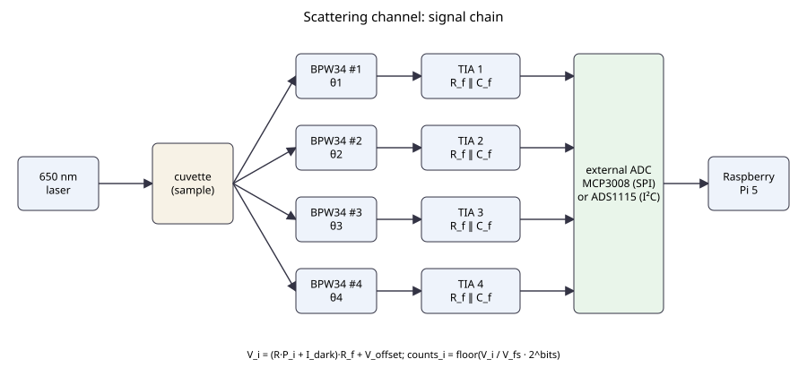

# Wiring and signal chain



Each of the four BPW34 photodiodes feeds its own transimpedance amplifier (TIA). The four
voltages go to an external ADC that the Raspberry Pi 5 reads over SPI (MCP3008) or I²C
(ADS1115). The Pi 5 has no analogue inputs.

```
BPW34 (reverse bias or zero bias) -> TIA (R_f || C_f) -> ADC channel i -> Raspberry Pi 5
```

## Equations

Optical power P_i on photodiode i gives the photocurrent and amplifier voltage

    I_i = R · P_i + I_dark          R: responsivity (A/W), I_dark: dark current
    V_i = I_i · R_f + V_offset      R_f: feedback resistance, V_offset: amplifier/ambient offset

and the ADC output

    counts_i = floor( V_i / V_fs · 2^bits ),   clipped to [0, 2^bits - 1]

| ADC | bits | full scale V_fs |
|---|---|---|
| MCP3008 | 10 | Vref = 3.3 V (3.2 mV per count) |
| ADS1115 | 15 usable, signed 16 | ±4.096 V at the chosen gain setting (0.125 mV per count) |

Design rule: choose R_f so that the largest expected signal stays below V_fs, and the blank
level (I_dark · R_f + V_offset) stays well below it. A 2 nA dark current with R_f = 100 Mohm
already gives 0.2 V, about 62 counts on the 10-bit ADC; the model removes it with a blank
reading per geometry. Noise terms: shot 2·q·I·B, Johnson 4·k·T·B / R_f, with B the
measurement bandwidth.

## Regenerating the diagram

    python docs/hardware/make_wiring_svg.py
